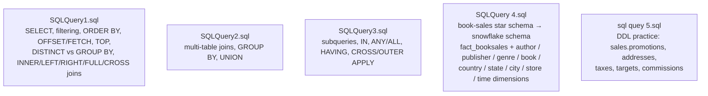

# T-SQL Practice — Queries, Joins & Dimensional Modelling

My SQL Server practice scripts. Most run against Microsoft's **BikeStores** sample database (`sales`, `production` and `hr` schemas). One script designs a book-sales **star schema** and its **snowflake-schema** variant.

## What's covered



## Tech stack

Microsoft SQL Server · T-SQL · SSMS

## How to run

1. Install SQL Server (Express or Developer) and SSMS or Azure Data Studio.
2. Create the BikeStores sample database, using the scripts from sqlservertutorial.net.
3. Open any `.sql` file and run it statement by statement. These are practice scripts, so they're not meant to run end to end.

## Project structure

```
SQLQuery1.sql     SQLQuery2.sql     SQLQuery3.sql     SQLQuery 4.sql     sql quey 5.sql
```

## Possible next steps

- Give the files descriptive names (`01_basics.sql`, `02_joins.sql`, `04_star_schema.sql` …)
- Split the star/snowflake-schema design into its own repo, with an ER diagram and sample queries
